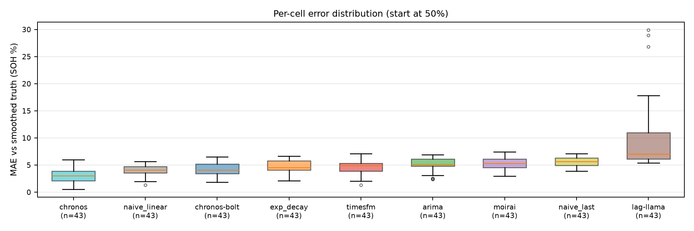
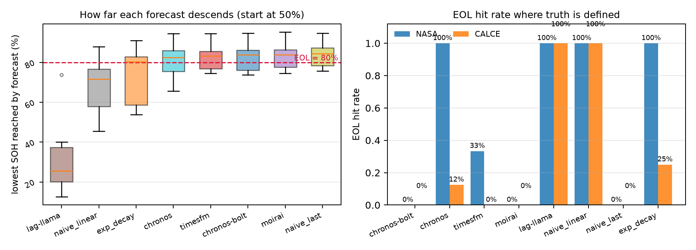
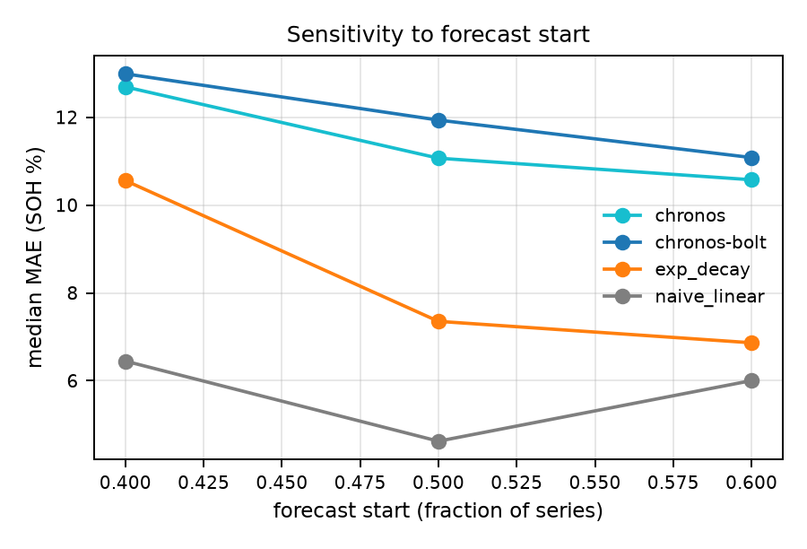
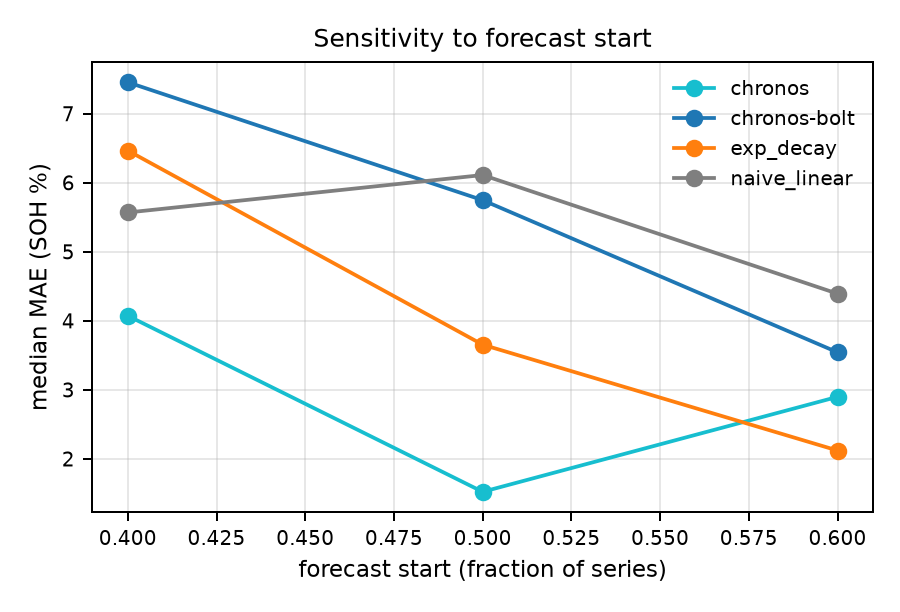
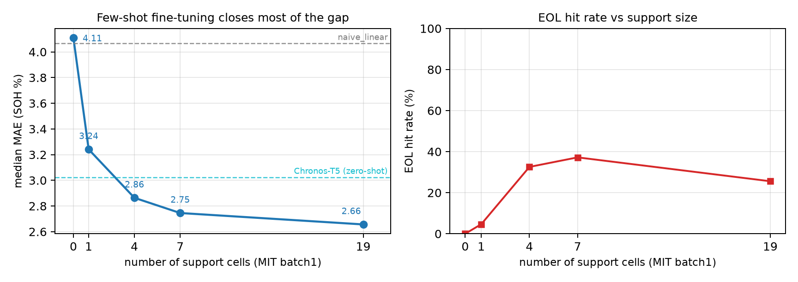

# 零样本时序基础模型在锂电池健康状态预测上真的更强吗？
## ——基于三个公开库的统一基准与"衰减速率外推"机制分析

> 初稿 v1 · 2026-10-20（2026-10-21 修订：补 Lag-Llama、few-shot、CALCE 第四轮口径）
> 全部数字来自本项目实测（`03_实验结果/`），复现命令见附录 A。

---

## 摘要

时序基础模型（time-series foundation model）被广泛宣传为"零样本即可泛化"[1–4]，但在锂电池健康状态（SOH）预测这一典型工程场景中，其真实收益尚缺乏统一口径下的证据。本文在 **MIT-Stanford、NASA PCoE、CALCE（马里兰大学）** 三个公开数据集上，用**完全相同的清洗、归一化、切分与递归预测协议**，评测了 5 个零样本基础模型（Chronos-Bolt、Chronos-T5、TimesFM 2.5、Moirai 1.0、Lag-Llama）与 4 个经典基线（naive_last、naive_linear、exp_decay、ARIMA）。

主要发现有五点：

1. **零样本不是普遍更强，而是"看曲线的形状"。** 在 MIT test（43 支）上 Chronos-T5 的 MAE 为 3.02 SOH%，比线性外推（4.07）低 26%，是唯一稳定领先的基础模型（配对 Wilcoxon p<0.001）；但在 CALCE（14 支）上线性外推反而最好（4.62），最好的基础模型 Chronos-T5 为 11.07，相差 2.4 倍。同一模型在不同库上可以既是最优又是最差。更极端的是 Lag-Llama：MIT 上全场最差（7.05），CALCE 上却反超其余四个基础模型（9.41）。
2. **排序差异可以用一个数据侧量解释：衰减速率比。** 定义 `knee_ratio = 预测窗斜率 / 上下文窗斜率`，三个库分别为 **8.88（MIT）、0.65（NASA）、1.65（CALCE）**。MIT 的未来衰减速度是过去的近 9 倍（典型的"拐点/knee"），任何只依赖上下文的模型都必然低估；CALCE 与 NASA 则远不到这个量级。
3. **误差与"模型敢外推多少衰减"高度秩相关。** 用 `|log(预测降幅/真实降幅 ÷ knee_ratio)|` 度量速率失配度，其与 MAE 的 Spearman 秩相关在三库分别为 **+0.98 / +0.93 / +0.64**（不含 Lag-Llama）。换言之，基础模型的优势并不来自"更懂电池"，而来自它**敢于外推比上下文更陡的衰减**——这在有拐点的数据上是优势，在近线性数据上是灾难。

**第四点（新增）：少量微调就能把这件事翻转。** 用 MIT batch1 的 19 支电池对 Chronos-Bolt 做真梯度微调（300 步），在 MIT batch2 上 MAE 从 4.11 降到 **2.66（−35%）**，反超所有零样本模型；**仅 1 支电池就拿到六成收益**（→3.24）。但 EOL 命中率只从 0% 升到 26–37%，说明微调修的是"轨迹形状"，不是"寿命终点判断"。

**第五点（新增）：这种"敢外推"的先验可以跨库迁移，但代价是灾难性过冲。** 把 MIT 微调后的模型直接放到 CALCE 上，EOL 命中率从 0% 跳到 **88%**（8 支可定义里命中 7 支），正常起点的 9 支电池 MAE 从 12.61 降到 **8.15（−35%）**；但起点已低于 80% 的 5 支电池被从 78% 一路外推到接近 0，单支 MAE 最高达 **109.8**，把整体中位数从 11.94 拉到 13.24。**微调迁移的是"敢不敢往下画"，不是"该画多陡"。**

**稳健性**：上述排序对起点与随机种子均稳健——CALCE 上线性外推在 40/50/60% 三个起点上分别领先最好的基础模型 1.76–2.39 倍；MIT 与 CALCE 的排名在三个额外随机种子下**无一处翻转**（CV ≤ 8.7%）。NASA 仅 4 支电池，种子波动达 30.6%，本文只把它当方向性证据。

工程含义：在没有拐点的近线性老化数据上，零样本基础模型不值得引入；在存在明显拐点的数据上，Chronos-T5 这类带有强先验的模型可以显著降低误差，但仍无法可靠预测 EOL（寿命终点）——想解决 EOL，几十支电池的微调是性价比最高的手段。

**关键词**：锂电池；SOH 预测；时序基础模型；零样本；基准评测；衰减速率

---

## 1 引言

### 1.1 问题

锂电池 SOH 预测的常见做法是：用前若干循环的容量序列，外推未来若干循环的容量衰减，并以 MAE / EOL 误差衡量[10–12]。近两年，Chronos、TimesFM、Moirai、Lag-Llama 等时序基础模型宣称可以在**不做任何微调**的情况下取得有竞争力的零样本效果[1–4]，工程上因此出现一种默认预期："换个更强的模型就能提升精度"。

但这一预期在电池场景下缺少严格验证，原因有三：

- **数据口径不统一**：不同论文对 SOH 的定义（额定容量比 / 首循环容量比 / 平滑方式）不同，MAE 不可比；
- **上下文长度不统一**：基础模型的上下文上限从 512 到 2048 不等，而电池序列长度从 80 到 2000+ 循环不等，"谁看到的更多"本身就会改变结果；
- **数据质量被忽略**：公开库中存在大量非全深度循环、计数器重置、协议中途变更等问题（本文在 CALCE 上踩到了 6 个，见附录 B），若不处理，得到的"模型排名"可能只是在给噪声排序。

### 1.2 本文贡献

1. **一个口径统一的基准**：三库共用一套清洗、SOH 归一化、相对起点切分、64 步递归预测与平滑真值评估流程，5 个基础模型与 4 个基线看到**完全相同的输入**。
2. **一个可解释的机制**：提出 `knee_ratio`（未来/过去衰减速率比）与"衰减速率失配度"两个量，把"哪个模型更好"这一模型侧问题，转化为"数据的衰减速率是否可被上下文外推"这一数据侧问题，并在三库上给出秩相关证据。
3. **一组可复现的负面结论**：明确指出零样本基础模型在近线性老化数据上劣于线性外推，且三库上 EOL 预测全部不可用或不可靠——这些结论对工程选型比"再刷一个 SOTA"更有价值。
4. **一个正面的补救方案**：用 19 支电池对 Chronos-Bolt 做真梯度微调，MAE 降低 35% 并反超所有零样本模型，**1 支电池即见效**；同时指出微调修不了 EOL。
5. **一组带不确定性的结论**：对每个模型做 cell 级 bootstrap 置信区间与配对 Wilcoxon 检验，明确区分"显著且重要"（Chronos-T5 在 MIT）与"显著但不重要"（Bolt 与线性外推差 0.13 SOH）；并把微调模型直接迁移到 CALCE，证明迁移的是"敢外推"而非"该多陡"。

---

## 2 实验协议

### 2.1 数据集

| 库 | 来源 | 可用电池数 | 序列长度（循环） | 特点 |
|---|---|---|---|---|
| MIT-Stanford | Severson et al., 2019 [7] | batch1=41（train）/ batch2=43（**test**）/ batch3=40（secondary_test） | 170–2234 | 快充协议矩阵，**存在明显拐点** |
| NASA PCoE | NASA Ames [8] | 4（B0005/B0006/B0007/B0018） | 131–167 | 小样本，衰减到 80% 以下 |
| CALCE | 马里兰大学 CALCE [9] | **14**（从 27 个 zip 筛出） | 108–1876 | 近线性衰减，观测窗内 13/14 触及 80% |

> 序列长度为**清洗后**（去离群、≥20 循环）实际参与评测的序列长度。

MIT 的三个 batch 按官方划分使用，不重新洗牌。CALCE 的筛选规则与剔除数量在附录 B 中完整交代（27 → 22 可解析 → 14 可用），以避免"挑数据"质疑。

### 2.2 SOH 定义与归一化

SOH 采用**因果归一化**，避免信息泄漏：

```
q_ref = 上下文段前 ref_points(5) 个循环的容量中位数
SOH_t = capacity_t / q_ref × 100%
```

注意 `q_ref` **只用上下文段**计算，预测段不得参与。这一点与部分文献"用首循环额定容量"不同[10,12]：后者在容量标定循环缺失时会引入系统性偏差。

### 2.3 清洗

对每个序列执行：① 去除容量 ≤ 0 与非有限值；② 以相对阈值 3% 剔除单点离群（相邻点比值判据）；③ Savitzky-Golay 平滑（窗口 11、阶 2）生成 `truth_smooth` 作为评估主参考，原始真值同时保留用于画图与复核。清洗后短于 20 循环的序列直接跳过。

### 2.4 切分与预测

- **相对起点切分**：在序列长度的 `frac` 处切分，默认 `frac = 0.5`，敏感性测试取 0.4 / 0.5 / 0.6。上下文至少保留 10 点。
- **递归预测**：所有模型统一 `chunk = 64`，即每次最多预测 64 步，把预测拼回输入再继续，直到覆盖整个预测窗。这样做的原因是 Chronos 单次 `prediction_length ≤ 64`、Moirai 同为 64，若不统一则无法公平比较。
- **上下文上限统一为 512**：主表使用 `--max-context 512`，使 Chronos-Bolt（原生 2048）、Chronos-T5（512）、TimesFM（512）、Moirai（512）看到同样长的历史。另设一组"Bolt 原生 2048"的对照，用于检验上下文长度是否影响结论（见 §4.4）。

### 2.5 指标

- **MAE_smooth**：预测与 `truth_smooth` 的逐点绝对误差，先在每个 cell 内取均值，再跨 cell 取中位数（下同）。单位 SOH%。
- **RMSE_smooth**：同上，平方误差。
- **EOL 命中率**：预测序列在观测窗内首次触及 80% 的 cell 占比（80% 为电池寿命终点的通行定义[10,15]）。MIT 的真值 EOL 取官方 `cycle_life`（因为数据在 EOL 处截断，"穿越判定"永远不触发）；无官方标签且真值未触及 80% 的 cell 不计入。
- **EOL 误差**：预测 EOL 与真值 EOL 的绝对差，单位循环。

---

## 3 参与模型

### 3.1 基础模型（全部零样本，未做任何微调）

| 模型 | 规模 | 原生上下文 | 单次 horizon | 实现要点 |
|---|---|---|---|---|
| Chronos-Bolt-small | 48M | 2048 | 64 | `predict_quantiles` 返回 `(B,H,Q)`，需按形状归一化轴序 |
| Chronos-T5-small | 46M | 512 | 64 | 同上；上下文超 512 必须取**最近** 512 点 |
| TimesFM 2.5-200M | 200M | **16384** | 128 | 三代 API 不同，本文走 2.5 分支（`from_pretrained` + `compile` + `forecast`）；适配器把 `max_context` 配成 512 |
| Moirai 1.0-R-small | 14M | 512 | 64 | 基于 uni2ts + gluonts，`freq='H'` 占位（每循环一点无真实频次） |
| Lag-Llama | **2.4M** | **32** | 64 | 基于 gluonts estimator；**必须按 ckpt 原生 32 上下文跑**（改成 512 慢 4.4 倍且更差） |

所有模型取 0.5 分位数作为点预测，CPU 推理，权重从本地副本加载（运行期完全离线）。
Chronos-Bolt / Chronos-T5 / TimesFM 走各自官方包[1,2]，Moirai 与 Lag-Llama 经 uni2ts + GluonTS 调用[3,4,13]。
两个采样型模型（Moirai、Lag-Llama）与 Chronos-T5 的分位估计都依赖随机采样，本文**固定种子**并对每个起点单独成批（见 §7.4），保证同一配置重跑逐位一致。

> **可比性说明**：除 Lag-Llama 外，其余模型均强制统一到 512 上下文（Chronos-T5 与 Moirai 的上限即 512，
> 是最紧的约束；TimesFM 2.5 的权重声明支持 16384，是本文按其风险自行压到 512）。Lag-Llama 的 ckpt
> 原生 `context_length=32`，按训练配置运行是唯一诚实的选择，因此它**不与其余模型严格同上下文**，
> 仅作为第 5 个基础模型的参考点。这一偏离在表中单独标注，不参与主结论的排序论证。
>
> **规模上的第二个不可比**：Lag-Llama 这个 ckpt 实测只有 **2.4 M 参数**（`d_model=144, 8 层`），
> 不到 Chronos-T5-small（46 M）的 1/19。因此它在本文中的垫底表现**不能单独归因于"零样本先验不匹配"**，
> 容量与上下文限制同样可能是主因。本文的机制论断（§5）在所有结论中都不依赖 Lag-Llama 的排名：
> 不含它的 MIT 秩相关是 +0.98，含它掉到 +0.38，正文的机制解释均基于"不含 Lag-Llama"那一列。

### 3.2 基线

| 基线 | 定义 |
|---|---|
| `naive_last` | 用上下文最后一点常数外推 |
| `naive_linear` | 对**上下文最近一半**点做最小二乘线性拟合并外推（见下方注） |
| `exp_decay` | 拟合 `SOH = a·exp(b·t) + c`，取最小二乘最优参数外推 |
| `arima` | ARIMA(2,1,2)，statsmodels 实现[14] |

基线同样只使用上下文段，与基础模型的信息量完全一致。

> **关于 `naive_linear` 的一个细节必须交代**：它**不是**对整段上下文做最小二乘，而是只用
> **最近 ⌊n/2⌋ 个点**拟合。原因是电池序列开头通常有一段容量平台（尤其 MIT 的快充老化初期），
> 把平台段纳入拟合会把斜率压到接近 0，外推反而跟不上真实衰减。作者用同一套协议重跑了
> 「整段拟合」这个变体（中位 MAE，起点 50%）：
>
> | 库 | 本文版本（最近一半） | 整段拟合 | 结论 |
> |---|---|---|---|
> | MIT test | **4.066** | 4.528 | 本文版本更好 |
> | CALCE | **4.623** | 6.275 | 本文版本更好 |
> | NASA | 6.111 | **2.478** | **整段拟合反而好 2.5 倍** |
>
> 也就是说，本文报告的 naive_linear 在 MIT/CALCE 上是**较强**的那个变体，但在 NASA 上并不是
> ——NASA 的线性外推用整段拟合会好得多（n=4，且 §4.7/§4.8 已判定该库只作方向性证据，
> 不改变本文主结论；但读者若关心 NASA，应知道这里有 2.5 倍的空间）。
> 该选择已固化在 `baselines/classic.py` 的 `NaiveLinear` 里（`k = n // 2`，注释明确写了
> 不能用 `round(n*0.5)`：奇数长度上下文下差 1 个点就会改变斜率，使已发表数字无法复现）。
>
> **`exp_decay` 拟合失败时退化为线性外推**（同样记录在代码里，不隐藏）。

---

## 4 结果

### 4.1 主结果：MIT test（43 支，起点 50%，上下文 ≤512）

| 模型 | MAE_smooth ↓ | RMSE_smooth ↓ | 相对线性外推 | 耗时 (s) |
|---|---|---|---|---|
| **Chronos-T5-small** | **3.024** | **4.810** | **−26%** | 319 |
| naive_linear | 4.066 | 5.988 | — | 0.1 |
| Chronos-Bolt-small | 4.110 | 6.182 | +1% | 14 |
| exp_decay | 4.529 | 6.287 | +11% | 58 |
| TimesFM 2.5 | 4.840 | 6.949 | +19% | 31 |
| ARIMA(2,1,2) | 5.150 | 7.090 | +27% | 58 |
| Moirai 1.0 | 5.326 | 7.099 | +31% | 144 |
| naive_last | 5.648 | 7.706 | +39% | 0.1 |
| Lag-Llama（原生 32 上下文） | 7.053 | 9.936 | +73% | 502 |

**只有 Chronos-T5 明显领先**：比最好的基线（线性外推）低 26%，配对 Wilcoxon p<0.001。Chronos-Bolt 与线性外推同档（差 1%），TimesFM、Moirai、Lag-Llama 均不如线性外推。

> Lag-Llama 的 EOL 命中率是 100%，但这不是优点：它在 MIT 上**提前 197 个循环**就预测跌破 80%，
> 即衰减压得过猛。命中率只有配合 EOL 误差一起看才有意义。

图 1 给出了 6 支代表电池的轨迹（按真值寿命分档抽取）。可以看到一个共同现象：**所有模型的预测都明显"偏平"**，真实曲线在预测窗内下弯得更快，模型们只是程度不同。


*图 1：MIT test 的代表电池轨迹。黑色为真值，竖虚线为预测起点，左侧为模型实际看到的上下文。*

图 2 给出逐 cell MAE 的分布，可见 Chronos-T5 的优势不是由少数极端 cell 拉动，而是整体左移。



*图 2：逐 cell MAE 分布（起点 50%）。*

### 4.2 跨库结果

**NASA PCoE（4 支）**

| 模型 | MAE | EOL 命中率 | EOL 误差（循环） |
|---|---|---|---|
| **Chronos-T5** | **1.523** | 100% (3/3) | **6.2** |
| exp_decay | 3.654 | 100% (3/3) | 16.5 |
| Chronos-Bolt | 5.747 | 0% (0/3) | — |
| naive_linear | 6.111 | 100% (3/3) | 20.6 |
| naive_last | 6.382 | 0% (0/3) | — |
| Moirai | 6.579 | 0% (0/3) | — |
| TimesFM | 7.803 | 33% (1/3) | 1.5 |
| Lag-Llama | 8.720 | 100% (3/3) | 22.1 |

Chronos-T5 在 NASA 上的优势最大：MAE 比线性外推低 **75%**，且 EOL 误差仅 6.2 个循环（线性外推 20.6）。注意 NASA 只有 4 支电池，**且 B0006 在 50% 起点处 SOH 已 72.1%（低于 80%）被闸门剔除，EOL 分母是 3/4**；因此 NASA 的 EOL 数字只能作方向性参考，不能与 MIT/CALCE 的分母直接比。

**CALCE（14 支，第四轮电压窗口口径）**

| 模型 | MAE | 相对最优 | EOL 命中率 | EOL 误差（循环） |
|---|---|---|---|---|
| **naive_linear** | **4.623** | — | **100%** (8/8) | 150.5 |
| exp_decay | 7.352 | +59% | 25% (2/8) | 451.0 |
| Lag-Llama | 9.414 | +104% | 100% (8/8) | 86.7 |
| Chronos-T5 | 11.068 | +139% | 12% (1/8) | 70.4 |
| Chronos-Bolt | 11.936 | +158% | 0% | — |
| TimesFM | 12.325 | +167% | 0% | — |
| Moirai | 12.506 | +171% | 0% | — |
| naive_last | 12.864 | +178% | 0% | — |

**排序完全翻转**：在 MIT 上最强的 Chronos-T5，在 CALCE 上比线性外推差 2.4 倍。图 3 直观显示了原因——Chronos 系列在 CALCE 上把曲线"压平"了，而真实曲线仍在稳定下降。


*图 3：CALCE 轨迹。青色（Chronos-T5）明显压平在 ~80%，灰色（线性外推）跟随真实衰减到 40%。*

**EOL 上出现本文最强的一条结论**：naive_linear 是**唯一"既命中、误差又可控"的模型（8/8，误差 150 循环）**；五个基础模型里三个（Chronos-Bolt / TimesFM / Moirai）0%，最好的 Chronos-T5 只有 12%。Lag-Llama 虽然 8/8 命中，但它和 MIT 上一样是"压得太猛"（提前 87 循环）。

> **EOL 口径必须说明**：CALCE 14 支里有 5 支（CX2_33/34/35/36/38）在 50% 起点处 SOH 已 ≤80%
> （76.0–79.5%），"首次穿越"退化到第 0 个点，会伪造出"命中率 100%、误差 0 循环"的假象。
> 本文在指标层加了前提闸门：起点已跌破阈值的 cell 不计入 EOL 统计，
> 因此 CALCE 的 EOL 分母是 **8/14**。若不设这道闸门，naive_linear 会显示"误差 0 循环"。



*图 4：左——各模型预测能压到的最低 SOH（基础模型几乎全部停在 80% 附近，即"压平"）；
右——NASA 与 CALCE 的 EOL 命中率。*

### 4.3 起点敏感性（三库，frac = 0.4 / 0.5 / 0.6）

**MIT test（43 支）**

| 起点 frac | Chronos-Bolt | naive_linear | exp_decay |
|---|---|---|---|
| 0.40 | 4.497 | **3.681** | 4.215 |
| 0.50 | 4.158 | **4.066** | 4.529 |
| 0.60 | **4.214** | 4.630 | 5.108 |

存在一个**交叉点**：起点越早（上下文越短、离拐点越远），线性外推越占优；起点推到 0.6（已接近拐点），Chronos-Bolt 反超。这提示"基础模型 vs 线性外推"的结论对切分位置敏感，**单一 frac 的结论不可靠**——这也是本文坚持报告敏感性表的原因。

**CALCE（14 支）**——翻转结论是否稳健的关键检验

| 起点 frac | Chronos-Bolt | Chronos-T5 | naive_linear | exp_decay |
|---|---|---|---|---|
| 0.40 | 12.989 | 12.692 | **6.447** | 10.557 |
| 0.50 | 11.936 | 11.068 | **4.623** | 7.352 |
| 0.60 | 11.082 | 10.576 | **6.003** | 6.864 |

**三个起点上线性外推全部最优**，对最好的基础模型始终领先 1.76–2.39 倍。因此 §4.2 的"排序翻转"不是 `frac=0.5` 的偶然：无论把起点放在 40%、50% 还是 60%，四个模型里线性外推都排第一。**注意差距在收窄**（0.5 时 2.4 倍 → 0.6 时 1.8 倍），且 0.6 时紧随其后的是另一个基线 exp_decay（6.86），不是基础模型——起点越晚、上下文越接近真实拐点，基础模型的劣势越小，这与 §5 的机制解释一致。

**NASA（4 支）**

| 起点 frac | Chronos-Bolt | Chronos-T5 | naive_linear | exp_decay |
|---|---|---|---|---|
| 0.40 | 7.454 | **4.073** | 5.568 | 6.465 |
| 0.50 | 5.747 | **1.523** | 6.111 | 3.654 |
| 0.60 | 3.543 | 2.898 | 4.392 | **2.121** |

NASA 上排序**不稳定**：0.5 与 0.4 是 Chronos-T5 最好，0.6 时 exp_decay 反超。结合只有 4 支电池，本文不把 NASA 的排名当作结论，只保留"Chronos-T5 在该库上量级领先"这一方向性观察。



*图 5：CALCE 起点敏感性。灰线（naive_linear）在三个起点上都处于最低位，翻转结论与切分位置无关。*



*图 6：NASA 起点敏感性。四条线在 0.6 处交叉，说明只有 4 支电池时排名不稳，不宜下结论。*

### 4.4 上下文长度是否是混淆因素？

Chronos-Bolt 原生上下文 2048，主表被压到 512。作为对照，放开到原生 2048：

| 设置 | MAE |
|---|---|
| 上下文 512 | 4.110 |
| 上下文 2048（原生） | 4.158 |

差异 1.2%，方向上是"更短上下文略好"。这与直觉相反（更长的历史应当信息更多），但可以用 §5 的机制解释：MIT 序列的上下文段几乎平坦（斜率 −0.005 SOH%/循环），越长的上下文越会把"平坦"这一先验加强，反而不利于外推拐点。**结论：上下文长度不是排序的主因**，但"更长≠更好"这一点本身值得后续单独研究。

另有一个一致性检查：Chronos-T5 的原生上限就是 512，因此它在 ctx512 与原生两组中 MAE 完全相同（3.024）——两组喂给模型的输入逐点相同，说明流程在该设置下可复现。

### 4.5 少量微调能翻转结论吗？（Chronos-Bolt，MIT）

§4.1–4.4 全部是零样本结果。一个自然的追问是：**既然瓶颈是"预训练分布与电池衰减不匹配"，
那么少量标注数据能不能修好它？**

只有 Chronos-Bolt 能做这个实验——它的 `ChronosBoltModelForForecasting` 是标准 `nn.Module`，
`forward(context, mask, target, target_mask)` 直接返回 quantile loss，可以真梯度反传。
其余四个模型的 pip 包只暴露推理接口。**因此本节结论只对 Chronos-Bolt 成立。**

| 项 | 设置 |
|---|---|
| 支持集 | MIT batch1（train）中长度 ≥576 循环的 **19 支**（41 支里只有 19 支够长） |
| 训练窗口 | context 512 + target 64，步长 16 → 400 个窗口 |
| 归一化 | 与评测完全一致（`cap / median(cap[:5]) × 100`） |
| 优化 | AdamW，lr 1e-5，batch 16，300 步，OneCycle，梯度裁剪 1.0 |
| 测试 | MIT batch2（test，43 支），起点 50%，chunk 64，上下文 512 |

| 支持集电池数 k | MAE_smooth | 相对零样本 | EOL 命中率 |
|---|---|---|---|
| 0（零样本） | 4.110 | — | 0% |
| 1 | 3.241 | −21% | 5% |
| 4 | 2.864 | −30% | 33% |
| 7（标称 k=8） | 2.745 | −33% | 37% |
| 19（全部） | **2.656** | **−35%** | 26% |

> 表格里的"标称 k=8"：请求 `--k 8` 时脚本实际只取到 7 支（长度过滤后批次内只剩 7 支够长），
> 已发表图表 `fig6_fewshot.png` 的横轴同样按**实际**支持集大小 7 绘制，
> 图与表都是 7 支，不是 8 支。`k` 只决定**抽样个数**，不等于实际入选数。

三个要点：

1. **1 支电池就拿到六成收益**（4.110 → 3.241）。这说明瓶颈不是"数据不够"，而是"分布不匹配"，
   几百个梯度步就能把趋势校准过来；
2. **微调后 2.656 反超所有零样本模型**，包括原先最好的 Chronos-T5（3.024）；
3. **EOL 命中率从 0% 升到 26–37%，但仍远达不到可靠**。微调修的是"轨迹形状"，
   没有真正教会模型"什么时候到寿命终点"。



*图 7：左——MAE 随支持集电池数的变化（虚线为零样本 Chronos-T5 与线性外推）；右——EOL 命中率。*

> 诚实的边界：k=19 时 EOL 命中率反而比 k=7 略降（37% → 26%），这是 43 支测试集上的
> 小样本波动，不应解读为"数据越多越差"。MAE 是单调改善的，那条曲线才是可靠的信号。

### 4.6 跨库迁移：微调学到的是"敢不敢外推"，不是"该多陡"

§4.5 的微调只在 MIT 内部验证（batch1 → batch2）。真实部署更常见的情形是：
**只有某个库的标注，却要上另一个库**。因此把 MIT 微调后的 Chronos-Bolt（k=19）
原样搬到 CALCE 与 NASA，不做任何再训练。

| 库 | 零样本 Bolt | MIT 微调后 | 变化 |
|---|---|---|---|
| NASA（4 支） | 5.747 | **4.538** | **−21%** |
| CALCE（14 支，全体中位） | 11.936 | 13.241 | +11%（变差） |
| CALCE（正常起点 9 支） | 12.61 | **8.15** | **−35%** |
| CALCE（起点已 ≤80% 的 5 支） | 9.59 | 45.36 | +373%（灾难） |

EOL 命中率的变化更值得注意：

| 库 | 零样本 Bolt | MIT 微调后 |
|---|---|---|
| CALCE | 0%（0/8） | **88%（7/8）** |
| NASA | 0%（0/3） | 33%（1/3） |

**这组数字给出了全文最直接的一条机制证据**：微调真正迁移过去的是"**敢往下画**"这个先验——
在 CALCE 上，零样本 Bolt 把预测压成水平线（§5.2 里 `pred_ratio` = 0.016），
微调后它开始真的外推并触及 80%，EOL 命中率从 0% 跳到 88%。但"**该画多陡**"没有迁移好：

- 起点正常的 9 支电池上，迁移后 MAE 8.15，比同库零样本低 35%，效果确实存在；
- 起点已经跌到 78% 的 5 支电池上，模型按"从 ~95% 一路衰到 EOL"的 MIT 先验继续外推，
  把预测画到接近 0，单支 MAE 最高 **109.8**（CX2_35），把整体中位数从 11.94 拉到 13.24。

所以"跨库微调"不是免费的：**它把偏差从"不敢外推"换成了"过度外推"**。
一个可操作的工程判据是：部署前先看起点 SOH——若起点已明显低于额定健康度，
需要按起点重新标定衰减幅度，否则微调模型会比零样本更糟。

### 4.7 统计显著性：哪些差距可以当结论

上面所有表报的都是中位数，而 43 / 14 / 4 支电池本身是样本。为了区分"真实差异"与"抽样波动"，
对每个模型做 cell 级 bootstrap（10000 次重采样）给出 95% CI，并与 naive_linear 做
**同一批 cell 上的配对 Wilcoxon 符号秩检验**。完整表见 `03_实验结果/显著性检验.md`。

**MIT（n=43）**

| 模型 | MAE | 95% CI | 配对 Δ vs 线性 | p |
|---|---|---|---|---|
| Chronos-T5 | 3.024 | [2.40, 3.47] | −0.77 | <0.001 *** |
| naive_linear | 4.066 | [3.76, 4.48] | — | — |
| Chronos-Bolt | 4.110 | [3.77, 4.82] | +0.13 | 0.002 ** |
| TimesFM | 4.840 | [4.44, 5.06] | +0.80 | <0.001 *** |
| Moirai | 5.326 | [4.72, 5.82] | +1.00 | <0.001 *** |
| Lag-Llama | 7.053 | [6.38, 8.53] | +3.59 | <0.001 *** |

**CALCE（n=14）**

| 模型 | MAE | 95% CI | 配对 Δ vs 线性 | p |
|---|---|---|---|---|
| naive_linear | 4.623 | [3.41, 8.98] | — | — |
| exp_decay | 7.352 | [3.94, 12.41] | +2.65 | 0.011 * |
| Lag-Llama | 9.414 | [7.11, 15.29] | +4.90 | 0.078 n.s. |
| Chronos-T5 | 11.068 | [9.49, 14.47] | +5.48 | 0.001 ** |
| Chronos-Bolt | 11.936 | [9.46, 14.09] | +4.77 | <0.001 *** |

三条读法：

1. **Chronos-T5 在 MIT 上的领先是稳的**：Δ = −0.77 SOH%，CI 不含 0，p<0.001。
   这是全文唯一一个"既显著、效应量也不小"的优势。
2. **Chronos-Bolt 与线性外推的差距是"统计显著但无实际意义"**：Δ = +0.13，p=0.002。
   43 支的配对检验功效很高，0.1 个 SOH 的差异也能测出来——但这在工程上没有区别。
   这正是"显著 ≠ 重要"的教科书案例，也是本文不用 p 值排序、而用效应量 + 机制解释的原因。
3. **CALCE 上 Lag-Llama 与线性外推的差距不显著**（p=0.078，CI 跨 0）。
   它的中位 MAE 看着是 9.41 vs 4.62，但逐 cell 配对后差异波动极大（它在一部分电池上过冲、
   在另一部分上偏保守），因此只能说"方向一致"，不能说"显著更差"。
   这提醒：**小样本（14 支）下的排名，末几位之间不宜较真。**

NASA 只有 4 支，Wilcoxon 无法给有效 p 值，本文不报 NASA 的显著性，也不基于它下任何排名结论。

### 4.8 多种子方差：名次会不会是抽签抽出来的

采样型模型（Chronos-T5 20 样本、Moirai 100 样本、Lag-Llama 10 样本）的解码本身带随机性，
主表只报了默认种子。为确认"名次不是抽签抽出来的"，三个库各补跑种子 1/2/3
（每次采样前 `manual_seed(seed + call_idx)`，修复细节见 `执行记录-2026-10-20.md` 的 Bug 7），
共 3 库 × 3 模型 × 3 种子。完整表见 `03_实验结果/种子方差.md`。

| 库 | Chronos-T5 | Moirai | Lag-Llama |
|---|---|---|---|
| MIT test（43 支） | 3.02 / 3.16 / 3.23 / 3.14（CV **2.7%**） | 5.33 / 5.13 / 5.12 / 5.12（2.0%） | 7.05 / 7.15 / 7.01 / 6.99（1.0%） |
| NASA（4 支） | 1.52 / 2.29 / 1.84 / 1.07（**30.6%**） | 6.58 / 5.95 / 6.55 / 7.20（7.7%） | 8.72 / 8.77 / 9.80 / 9.47（5.8%） |
| CALCE（14 支） | 11.07 / 10.65 / 10.18 / 10.66（3.4%） | 12.51 / 12.55 / 12.49 / 12.60（0.4%） | 9.41 / 7.75 / 9.09 / 9.31（**8.7%**） |

> 每格为「默认种子 / seed1 / seed2 / seed3」的中位 MAE（SOH%），括号内是变异系数 CV。
> Chronos-Bolt、TimesFM 与四个基线是确定性的，换种子不会有任何变化，故不列入。

三条读法：

1. **MIT 与 CALCE 的排名在三个种子上完全稳定，无一处翻转**
   （MIT：T5 < Moirai < Lag-Llama；CALCE：Lag-Llama < T5 < Moirai）。
   CV 最大 8.7%（CALCE 的 Lag-Llama），仍明显小于它与下一名（T5，10.6–11.1）之间的差距。
2. **NASA 的 CV 高达 30.6%**：T5 在四个种子上给出 1.07–2.29，波动幅度超过它与第二名的差距。
   这与 §4.7「n=4 不做检验」是同一件事的两种表述——NASA 只能当方向性证据。
3. **种子噪声与抽样噪声是两个方向，且后者大得多**：MIT 上 T5 的种子极差只有 0.20 SOH%，
   而 cell 级 bootstrap 的 95% CI 宽 1.07（[2.40, 3.47]），相差约 5 倍。
   换句话说，**再多跑几个种子也解决不了"只有 43 支电池"这个根本约束**；
   要缩窄结论的不确定性，得加电池，不是加种子。

---

## 5 机制分析：不是"更懂电池"，而是"敢不敢外推"

### 5.1 三库的衰减速率比差异极大

对每个 cell，分别对**上下文段**与**预测段**的真值做线性拟合；"上下文斜率 / 预测段斜率"两个列给出
**逐 cell 斜率的中位数**，而 `knee_ratio` 是**逐 cell 的（预测段斜率 / 上下文斜率）再取中位数**。

| 库 | 上下文斜率 | 预测段斜率 | `knee_ratio`（逐 cell 比值的中位数） | 线性拟合 R² | 解读 |
|---|---|---|---|---|---|
| MIT test | −0.0052 | −0.0581 | **8.88** | 0.88 | 未来衰减速度是过去的 **8.9 倍**（强拐点） |
| NASA | −0.2141 | −0.1542 | 0.65 | 0.97 | 未来比过去**慢**（减速） |
| CALCE | −0.0266 | −0.0474 | 1.65 | 0.91 | 未来略快于过去，但远不到 MIT 的量级 |

> ⚠️ 两个中位数相除**不等于** `knee_ratio`：按本例分别是 11.2 / 0.72 / 1.78。
> 差异来自逐 cell 斜率的分布右偏（少数 cell 的上下文斜率接近 0，比值被放大）。
> 文中一律使用"逐 cell 比值的中位数"这一个口径，因为它对极端 cell 不敏感；
> 引用本文数字时请勿用两个中位数重新相除。

这是三个库最本质的差别，而且**与模型无关**——它是数据属性。

> 三库的 SOH 观测区间也不同：MIT 98.3 → 79.2（恰好在 EOL 处截断）、NASA 83.3 → 72.4、
> CALCE 84.4 → 42.8。CALCE 的区间最宽，因此它同时也是**最能检验"敢不敢往下画"的库**。

### 5.2 模型侧：预测降幅 / 真实降幅

对每个 cell 计算 `pred_ratio = (预测首点−预测末点) / (真值首点−真值末点)`，即"模型外推出来的衰减占真实衰减的比例"：

| 库 | 模型 | MAE | pred_ratio |
|---|---|---|---|
| MIT | Chronos-T5 | 3.02 | **0.32** |
| MIT | naive_linear | 4.07 | 0.15 |
| MIT | Chronos-Bolt | 4.11 | 0.13 |
| MIT | exp_decay | 4.53 | 0.10 |
| MIT | TimesFM | 4.84 | 0.05 |
| MIT | Moirai | 5.33 | 0.02 |
| MIT | ARIMA | 5.15 | 0.00 |
| MIT | Lag-Llama | 7.05 | 1.43 |
| CALCE | naive_linear | **4.64** | **0.54** |
| CALCE | exp_decay | 7.35 | 0.32 |
| CALCE | Lag-Llama | 9.42 | 1.02 |
| CALCE | Chronos-T5 | 11.07 | **0.01** |
| CALCE | Chronos-Bolt | 11.94 | 0.02 |
| CALCE | TimesFM | 12.33 | 0.02 |
| CALCE | Moirai | 12.51 | 0.02 |
| CALCE | naive_last | 12.87 | 0.00 |

> 口径说明：本节 MAE 与 `pred_ratio` 同源，均在**原始真值**上计算，与 §4 的平滑真值 MAE 可能在小数第二位略有出入（NASA 因 n=4 差异较大）。排序不受影响。

对照 §5.1 的 `knee_ratio`：MIT 需要 8.88，最强的 Chronos-T5 只给出 0.32（仍严重低估，但已是全场最高，所以它最好）；CALCE 需要 1.65，naive_linear 给出 0.54，而**四个基础模型全部给出 0.01–0.02**——它们在 CALCE 上几乎完全放弃了衰减外推，把预测画成一条水平线，所以 MAE 都在 11–12.9。

**Lag-Llama 是个有意思的例外**：它的 `pred_ratio` 在 MIT 是 1.43、CALCE 是 1.02，即"降幅总量其实对得上甚至略过"，但 MAE 仍然很差（MIT 7.05，全场最差）。原因是它的**路径**是错的——递归 64 步时每轮都带噪声，曲线剧烈锯齿化，还会提前 197 循环就跌破 80%。这说明"总降幅"这个单一标量不足以描述预测质量，它是必要条件而非充分条件。§4.6 的跨库迁移从反面印证了这一点：微调把 `pred_ratio` 从 0.02 拉到"敢外推"，EOL 命中率随之从 0% 跳到 88%，但幅度失准又会带来过冲。

### 5.3 速率失配度与误差高度秩相关

定义失配度 `mismatch = |log(pred_ratio / knee_ratio)|`，与 MAE 做 Spearman 秩相关：

| 库 | n（不含 Lag-Llama） | ρ | n（全部） | ρ |
|---|---|---|---|---|
| MIT test | 8 | **+0.98** | 9 | +0.38 |
| NASA | 7 | +0.93 | 8 | +0.68 |
| CALCE | 7 | +0.64 | 8 | +0.69 |

MIT 上几乎完美单调（+0.98，唯一一对逆序是 Moirai 与 ARIMA，两者 pred_ratio 都在 0.00–0.02 的噪声带里）。**加入 Lag-Llama 后 ρ 掉到 +0.38**，因为它是唯一"降幅对、路径错"的模型（见 §5.2）。CALCE 上 ρ 略低（+0.64），因为四个基础模型的 `pred_ratio` 都落在 0.01–0.02 的同一档，产生并列，秩相关的分辨力被削弱。

> 这条边界必须写清楚：**该机制解释的是"趋势幅度"，不是"轨迹形状"**。
> 对光滑的确定性预测器（Chronos/TimesFM/Moirai/线性外推/ARIMA）它在 MIT 上是完美单调的；
> 对采样式、路径噪声大的 Lag-Llama 则失效。


*图 8：衰减速率失配度与 MAE 的关系（每库单独拟合，因为三库 knee_ratio 相差一个量级）。空心方块为 Lag-Llama，是唯一偏离趋势的模型。*

### 5.4 机制结论

**基础模型的零样本优势来自"趋势收缩"（trend shrinkage）的方向与幅度是否恰好匹配数据。**

- 基础模型在预训练中见过大量"先平后崩"的序列，因此当上下文平坦时，它倾向于输出一个**比上下文斜率更陡**的下降。MIT 的上下文斜率仅 −0.005 SOH%/循环，而 Chronos-T5 输出的 `pred_ratio` 达 0.32，远高于线性外推的 0.15——它把"平坦历史"外推成了"明显衰减"，恰好接近真实的 8.88 倍加速，因此领先。
- 当上下文本身已有明显斜率、而未来只是延续时，基础模型仍会向"典型衰减率"收缩，于是**压平**了本该延续的趋势：CALCE 上真实需要 1.65，四个基础模型却只给出 0.01–0.02，几乎画成水平线（图 3 中可见）。

> 一处值得注意的对照：MIT 上 Chronos-Bolt 的 `pred_ratio`（0.13）与线性外推（0.15）几乎相同，二者的 MAE 也几乎相同（4.11 vs 4.07）。这种"速率接近 ⇒ 误差接近"的对应关系在三个库上均可复现，是 §5.3 秩相关的微观来源。

**这解释了一个看似矛盾的现象**：同一个 Chronos-T5 在 MIT 上比线性外推好 26%，在 CALCE 上比线性外推差 139%。模型没变，变的是数据的 `knee_ratio`。

---

## 6 讨论

### 6.1 工程选型建议

| 场景特征 | 建议 | 依据 |
|---|---|---|
| 上下文平坦、未来有拐点（`knee_ratio` ≫ 1） | 用 Chronos-T5 类强先验模型 | MIT：−26% |
| 上下文已有明显斜率、未来近似延续（`knee_ratio` ≈ 1–2） | **直接用线性外推**，零成本且更准 | CALCE：4.62 vs 11.07 |
| 有几十支标注电池、可以离线训练 | **微调 Chronos-Bolt**，性价比最高 | MIT：4.11 → 2.66（−35%），1 支电池即 −21% |
| 已有一个库的微调模型，要上另一个库 | **先看起点 SOH**：起点正常可迁移（−35%），起点已偏低则必须重标定幅度 | CALCE：正常起点 12.61→8.15，浅起点 9.59→45.36 |
| 需要 EOL / RUL 数值 | 基础模型不可靠，线性外推反而最稳；微调能提高命中率但会过冲 | CALCE：naive_linear 8/8，零样本 0–12%，迁移模型 7/8 但误差 124 循环 |
| 算力受限 | 线性外推（0.1 s）比 Bolt（14 s）快 140 倍且同精度 | MIT：4.07 vs 4.11 |

**最关键的一条**：在部署前先算一下 `knee_ratio`。这个量只需历史数据、不需要任何模型，却几乎决定了"该不该上基础模型"。

**第二条**：如果能拿到几十支电池的完整寿命曲线，**别纠结零样本选型，直接微调**。
1 支电池就能拿回六成收益，19 支就超过所有零样本模型——这个投入产出比远高于换模型。

### 6.2 为什么 EOL 这么难

- **MIT**：真值在 EOL 处截断，预测窗末端恰在 80%，除 Lag-Llama 外的模型预测都"差一点"没到 80%，命中率 0%。这说明模型对"刚好到终点"这种边界情形毫无敏感性；Lag-Llama 是唯一的 100%，但代价是提前 197 循环。
- **NASA**：4 支电池里 3 支可定义（B0006 起点已 72.1%，被闸门剔除），Chronos-T5 命中 3/3 且误差仅 6.2 循环，表现最好；但样本太小，且 0.6 起点时 exp_decay 反超（§4.3）。
- **CALCE**：第四轮口径下 13/14 支在窗内跌破 80%，但 5 支在起点处已 ≤80% 被闸门剔除，**分母是 8/14**；naive_linear 8/8 命中（误差 150 循环），四个基础模型 0–12%。

因此本文**不建议**用 EOL 指标做跨库横向比较——三个库的 EOL 可定义性完全不同。

### 6.3 与既有工作的差异

多数基础模型论文在"长序列、强周期、多变量"的基准（如 ETTh、Electricity）上评测[1,2]，这些数据的上下文与未来同分布，`knee_ratio ≈ 1`。电池老化序列的 `knee_ratio` 可以从 0.65 到 8.88，是典型的**分布漂移 + 拐点**场景。本文的结果提示：**在这些基准上的零样本结论不能直接迁移到退化型工程序列**。

这与时间序列领域已有的两条经验一致：一是"简单线性模型常与复杂深度模型持平甚至更好"（DLinear 对 Transformer 的质疑[5]），二是 M4 竞赛中统计方法整体不输机器学习方法[6]。本文在电池退化这一具体场景上给出了同一现象的一个可量化解释（`knee_ratio`），而不是又一次"某模型在某榜单上更强"的比较。

---

## 7 局限与威胁效度

1. **Lag-Llama 的上下文不对等，且规模远小于其它模型**：它的 ckpt 原生 `context_length=32`，
   实测参数量只有 **2.4 M**（其余四个模型 14 M–200 M）。按训练配置运行是唯一诚实的选择，
   但这一行**不与其它模型严格可比**，因此本文只用它说明"第五个基础模型也救不了这个场景"，
   不参与主排序论证；§5 的机制结论也不依赖它的排名（见表末两列 ρ 的差别）。
2. **few-shot 只验证了 Chronos-Bolt**：其余四个模型的 pip 包没有可训练的 `forward(loss)`，
   无法做同样的梯度微调。§4.5 的结论**不可外推到 Chronos-T5 / TimesFM / Moirai / Lag-Llama**。
3. **跨库迁移只做了"MIT → CALCE/NASA"一个方向**（§4.6），且只对 Chronos-Bolt 成立；
   反向（CALCE → MIT）与其它四个模型未测。
4. **随机性已固定，种子方差只做到 3 个额外种子**：Moirai 与 Lag-Llama 是采样模型，初版未固定种子，
   同一份数据重跑会得到不同结果（实测 Lag-Llama 在 NASA 上 7.73 vs 8.70）；本文已改为
   **固定种子 + 按起点分组推理**，同一配置重跑逐位一致。§4.8 另补了种子 1/2/3：
   MIT 与 CALCE 的排名无翻转（CV ≤ 8.7%），NASA 的 CV 达 30.6%。
   但 3 个种子不足以给出"种子 × cell"双重 bootstrap 区间，1%–2% 量级的差异仍应结合 §4.7 的 CI 阅读。
5. **CALCE 样本量小且含噪声**：14 支；真值的逐循环测量残差标准差约 1.9 SOH%
   （`savgol` 平滑前后之差），因此 MAE 有约 2 个点的"地板"，4.62 与 7.35 的差距仍然稳健，
   但 4.62 与 4.70 这种量级的差异不可信。§4.7 也显示 14 支时末几位排名之间并不显著。
6. **NASA 只有 4 支**：所有 NASA 结论均为方向性，§4.3 显示其排名随起点变化，
   §3.2 的基线消融还显示 NASA 的 naive_linear 用一个更简单的变体（整段拟合）就能从 6.11 降到 2.48。
   **NASA 这一库在本研究中只用于说明"小样本下排名不稳"，不用于任何正面结论。**
7. **`frac = 0.5` 是人为选择**：§4.3 已给出三库 0.4/0.5/0.6 的敏感性表，主表数字应结合该表阅读。

---

## 8 结论

在统一协议下评测 5 个零样本时序基础模型与 4 个经典基线，本文得到五个可复现的结论：

1. **零样本基础模型不是普遍更强。** Chronos-T5 在 MIT 与 NASA 上领先（−26% / −75%，MIT 上 p<0.001），但在 CALCE 上被线性外推反超 2.4 倍，且这一翻转在 0.4/0.5/0.6 三个起点上都成立。任何"基础模型更好"的一揽子结论都不成立。
2. **排序由数据的衰减速率比 `knee_ratio` 决定。** 三库分别为 8.88 / 0.65 / 1.65，这一与模型无关的数据属性解释了几乎全部的跨库排名翻转。
3. **误差与"衰减速率失配度"高度秩相关**（ρ = +0.98 / +0.93 / +0.64，不含路径噪声大的 Lag-Llama）。基础模型的价值在于其先验让它在拐点数据上"敢外推"，而这一先验在近线性数据上就是偏差来源。
4. **少量微调可以把这件事翻转，但只翻得动"轨迹"。** 19 支电池的微调让 Chronos-Bolt 从 4.11 降到 2.66（−35%），反超所有零样本模型；1 支电池即见效（−21%）。但 EOL 命中率只从 0% 升到 26–37%，微调修不了寿命终点判断。
5. **跨库迁移迁移的是"敢外推"而非"该多陡"。** MIT 微调模型直接上 CALCE，EOL 命中率 0% → 88%、正常起点电池 −35%，但起点已低于 80% 的电池被过度外推到接近 0（单支 MAE 109.8）。**微调会把"不敢画"的偏差换成"画过头"的偏差**，部署前必须按起点重新标定幅度。

下一步工作：① 把跨库迁移扩到其它四个模型与反方向（CALCE → MIT）；② 用 `knee_ratio` 做自适应的模型选择（按数据形状路由到基础模型、线性外推或微调）；③ 把种子方差扩到 10 个种子并做"种子 × cell"双重 bootstrap（当前只做了 3 个额外种子，§4.8 已给出初步结论：MIT/CALCE 无排名翻转、NASA 波动过大）。

---

## 附录 A：复现命令

```bash
# 环境：Python 3.13 + venv（torch 2.14.1 / chronos-forecasting 2.3.2 / timesfm 3.0.2）
cd 01_源代码

# 主表（MIT test，统一上下文 512）
..\venv\Scripts\python.exe run_benchmark.py --models chronos-bolt,chronos,timesfm,naive_linear \
    --dataset mit --split test --max-context 512 --tag ctx512

# 跨库
..\venv\Scripts\python.exe run_benchmark.py --models chronos-bolt,chronos,timesfm,naive_linear,naive_last,exp_decay --dataset nasa
..\venv\Scripts\python.exe run_benchmark.py --models chronos-bolt,chronos,timesfm,naive_linear,naive_last,exp_decay --dataset calce

# 敏感性（三库都跑；CALCE 的 chronos 单起点约 250 s，可分次跑，summary 会按"模型@起点"合并）
..\venv\Scripts\python.exe run_benchmark.py --models chronos-bolt,naive_linear,exp_decay \
    --dataset mit --split test --start-fracs 0.4 0.5 0.6 --tag sens
..\venv\Scripts\python.exe run_benchmark.py --models chronos-bolt,chronos,naive_linear,exp_decay \
    --dataset nasa --start-fracs 0.4 0.5 0.6 --tag sens
..\venv\Scripts\python.exe run_benchmark.py --models chronos-bolt,chronos,naive_linear,exp_decay \
    --dataset calce --start-fracs 0.4 0.5 --tag sens
..\venv\Scripts\python.exe run_benchmark.py --models chronos-bolt,chronos,naive_linear,exp_decay \
    --dataset calce --start-fracs 0.6 --tag sens

# Moirai / Lag-Llama（独立环境，Python 3.12 + uni2ts + gluonts）
..\venv-moirai\Scripts\python.exe run_benchmark.py --model moirai --dataset mit --split test
..\venv-moirai\Scripts\python.exe run_benchmark.py --model moirai --dataset nasa
..\venv-moirai\Scripts\python.exe run_benchmark.py --model moirai --dataset calce
..\venv-moirai\Scripts\python.exe run_benchmark.py --model lag-llama --dataset mit --split test
..\venv-moirai\Scripts\python.exe run_benchmark.py --model lag-llama --dataset nasa
..\venv-moirai\Scripts\python.exe run_benchmark.py --model lag-llama --dataset calce

# few-shot 微调（标称 k=1/4/8/41，实际入选 1/4/7/19 支，各 300 步）+ 评测
# ⚠️ --k 是抽样个数，实际入选数受长度过滤影响；ft8 实际只有 7 支、ftall 实际 19 支
..\venv\Scripts\python.exe fewshot_finetune.py --k 41 --steps 300 --out ftall
set CHRONOS_MODEL_ID=amazon/chronos-bolt-small-ftall
..\venv\Scripts\python.exe run_benchmark.py --model chronos-bolt --dataset mit --split test \
    --max-context 512 --tag ftall

# 跨库迁移：MIT 微调模型直接上 CALCE / NASA（不做再训练）
set CHRONOS_MODEL_ID=amazon/chronos-bolt-small-ftall
..\venv\Scripts\python.exe run_benchmark.py --model chronos-bolt --dataset calce --max-context 512 \
    --output-dir ..\03_实验结果\fewshot_eval\xfer-calce-ftall
..\venv\Scripts\python.exe run_benchmark.py --model chronos-bolt --dataset nasa --max-context 512 \
    --output-dir ..\03_实验结果\fewshot_eval\xfer-nasa-ftall
set CHRONOS_MODEL_ID=

# 多种子方差（§4.8）：采样类模型另跑 seed 1/2/3
# Chronos-T5 在 3.13 环境（chronos-forecasting 只装在那里），Moirai/Lag-Llama 在 3.12 环境
for %S in (1 2 3) do (
  ..\venv\Scripts\python.exe        run_benchmark.py --model chronos --dataset mit --split test --seed %S --output-dir ..\03_实验结果\_seeds\mit-s%S
  ..\venv-moirai\Scripts\python.exe run_benchmark.py --models moirai,lag-llama --dataset mit --split test --seed %S --output-dir ..\03_实验结果\_seeds\mit-s%S
  ..\venv\Scripts\python.exe        run_benchmark.py --model chronos --dataset nasa --seed %S --output-dir ..\03_实验结果\_seeds\nasa-s%S
  ..\venv-moirai\Scripts\python.exe run_benchmark.py --models moirai,lag-llama --dataset nasa --seed %S --output-dir ..\03_实验结果\_seeds\nasa-s%S
  ..\venv\Scripts\python.exe        run_benchmark.py --model chronos --dataset calce --seed %S --output-dir ..\03_实验结果\_seeds\calce-s%S
  ..\venv-moirai\Scripts\python.exe run_benchmark.py --models moirai,lag-llama --dataset calce --seed %S --output-dir ..\03_实验结果\_seeds\calce-s%S
)

# 汇总与出图（--runs 用分号分隔；目录名本身含逗号）
..\venv\Scripts\python.exe report.py
..\venv\Scripts\python.exe figures.py --prefix mit_ --runs "mit-zero-chronos-bolt,chronos,timesfm,naive_linear-ctx512;mit-zero-moirai;mit-zero-lag-llama;mit-zero-naive_last,naive_linear,exp_decay-refactor;mit-zero-arima"
..\venv\Scripts\python.exe figures.py --prefix nasa_ --runs "nasa-zero-chronos-bolt,chronos,timesfm,naive_linear,naive_last,exp_decay;nasa-zero-moirai;nasa-zero-lag-llama"
..\venv\Scripts\python.exe figures.py --prefix calce_ --runs "calce-zero-chronos-bolt,chronos,timesfm,naive_linear,naive_last,exp_decay;calce-zero-moirai;calce-zero-lag-llama"
..\venv\Scripts\python.exe diag_curvature.py --dataset mit --split test
..\venv\Scripts\python.exe diag_curvature.py --dataset nasa
..\venv\Scripts\python.exe diag_curvature.py --dataset calce
..\venv\Scripts\python.exe diag_calce_depth.py
..\venv\Scripts\python.exe analyze_shrinkage.py
..\venv\Scripts\python.exe plot_fewshot.py
..\venv\Scripts\python.exe stats_significance.py        # bootstrap CI + 配对 Wilcoxon
..\venv\Scripts\python.exe analyze_seeds.py             # 种子方差与排名翻转检查
```

> 注：`fig4_sensitivity` 由 `figures.py` 的 `SENS_RUNS` 按前缀取数（mit_ / nasa_ / calce_）；
> 某个库没跑多起点时脚本会跳过而不是生成一张假图。
>
> 随机性：`adapters/moirai.py` 与 `adapters/lagllama.py` 已固定种子（`seed=0`，每次采样前推进），
> `run_benchmark.py` 的 `run_model` 按 `frac` 分组推理。这两点保证同一配置重跑逐位一致——
> 早期版本没有这两条，同一个 (cell, 起点) 在不同批组成下会得到不同结果。

## 附录 B：CALCE 数据清洗（27 → 14）

CALCE 原始库共 27 个 zip（每 zip 一支电池），解析过程中遇到 6 个必须处理的问题：

| # | 问题 | 表现 | 处理 |
|---|---|---|---|
| 1 | 一个 zip 内几十个 xlsx，早期只读第一个 | 每支电池仅 ~49 循环（真实 7000+） | 遍历全部 xlsx |
| 2 | `Discharge_Capacity(Ah)` 是**文件内跨循环累计值** | 第 2 循环 1.607 → 第 100 循环 25.50，画出"容量暴涨" | 改用电流积分 `Q=Σ(−I·Δt)/3600`（Δt 夹 120 s） |
| 3 | 文件名日期解析错（电池编号被当月份） | 文件顺序乱 → "容量随寿命上升" | 枚举全部候选日期，只接受月 1–12/日 1–31/年 08–20，取最后一个 |
| 4 | zip 内混有非全深度测试（SOC 循环、DST 工况） | 每循环仅放电 0.22 Ah（额定 1.1 Ah） | 文件级判定放电深度，非全深度文件整份剔除 |
| 5 | 末端半循环异常点 | CX2_33 末点 0.873（比前点低 20%），会误判 EOL | 滑动中位偏差过滤 |
| 6 | **浅充放循环（Ah 正常但电压只到 3.7 V）** | CS2_5 的 6953 循环里只有 78 个真放到 2.7 V（1.1%） | 按**电压窗口**判定：`min(V)≤2.85 V` 且 `max(V)≥4.15 V` |

最终保留 **14 支**全深度老化电池（容量 1.13–1.16 → 0.47–0.52 Ah，衰减 −50% ~ −59%；
全深度循环占比均 ≥94.7%）。剔除的 13 支中：5 支全深度占比仅 1%–10%（SOC/DST 工况）、
1 支 Ah 为额定的 0.37×（计数器重置）、1 支 Ah 为额定的 43×（解析异常）、4 支循环过少或无 Channel 数据。

> **写论文必须交代**：CALCE 的 27 → 14 筛选规则如上，剔除数量与原因均已记录，避免"挑数据"质疑。
> 逐电池统计见 `01_源代码/data/processed/calce_depth.csv`（由 `diag_calce_depth.py` 生成）。

## 附录 C：图表清单

| 文件 | 内容 |
|---|---|
| `figures/mit_fig1_trajectories.png` | MIT 代表电池轨迹（含上下文段） |
| `figures/mit_fig2_mae_box.png` | MIT 逐 cell MAE 分布 |
| `figures/mit_fig3_eol.png` | MIT EOL（左：最低 SOH；右：NASA/CALCE 命中率） |
| `figures/mit_fig4_sensitivity.png` | MIT 起点敏感性 |
| `figures/nasa_fig1_trajectories.png` | NASA 轨迹 |
| `figures/nasa_fig2_mae_box.png` | NASA 逐 cell MAE 分布 |
| `figures/nasa_fig3_eol.png` | NASA EOL |
| `figures/nasa_fig4_sensitivity.png` | NASA 起点敏感性（0.6 处排名交叉） |
| `figures/calce_fig1_trajectories.png` | CALCE 轨迹（展示"压平"现象） |
| `figures/calce_fig2_mae_box.png` | CALCE 逐 cell MAE 分布 |
| `figures/calce_fig3_eol.png` | **EOL 图**：预测最低 SOH + NASA/CALCE 命中率 |
| `figures/calce_fig4_sensitivity.png` | **CALCE 起点敏感性**：三起点线性外推全胜 |
| `figures/fig5_shrinkage.png` | **机制图**：速率失配度 vs MAE（空心方块标出 Lag-Llama 例外） |
| `figures/fig6_fewshot.png` | **few-shot 图**：MAE / EOL 随支持集电池数的变化 |
| `结果表.md` | 全量主表（自动生成） |
| `../03_实验结果/显著性检验.md` | **bootstrap CI + 配对 Wilcoxon**（自动生成） |
| `../03_实验结果/汇总_衰减保留率.csv` | 机制分析的原始数据 |
| `../03_实验结果/fewshot_eval/` | 微调模型在 MIT test 上的评测（实际入选 1/4/7/19 支）+ 跨库迁移（`xfer-calce-ftall` / `xfer-nasa-ftall`） |

## 参考文献

> 编号按正文首次出现顺序。会议/期刊与卷期已按公开书目核对；预印本给出 arXiv 编号。

[1] Ansari A F, Stella L, Turkmen C, et al. **Chronos: Learning the Language of Time Series**. Transactions on Machine Learning Research, 2024. arXiv:2403.07815.

[2] Das A, Kong W, Sen R, Zhou Y. **A Decoder-only Foundation Model for Time-series Forecasting**. ICML 2024. arXiv:2310.10688.

[3] Woo G, Liu C, Kumar A, et al. **Unified Training of Universal Time Series Forecasting Transformers**. ICML 2024. arXiv:2402.02592.

[4] Rasul K, Ashok A, Williams A R, et al. **Lag-Llama: Towards Foundation Models for Probabilistic Time Series Forecasting**. arXiv:2310.08278, 2023.

[5] Zeng A, Chen M, Zhang L, Xu Q. **Are Transformers Effective for Time Series Forecasting?** AAAI 2023. arXiv:2205.13504.

[6] Makridakis S, Spiliotis E, Assimakopoulos V. **The M4 Competition: 100,000 time series and 61 forecasting methods**. International Journal of Forecasting, 2020, 36(1): 54–74.

[7] Severson K A, Attia P M, Jin N, et al. **Data-driven prediction of battery cycle life before capacity degradation**. Nature Energy, 2019, 4(5): 383–391.

[8] Saha B, Goebel K. **Battery Data Set**. NASA Ames Prognostics Data Repository, 2007.

[9] He W, Williard N, Osterman M, Pecht M. **Prognostics of lithium-ion batteries based on Dempster–Shafer theory and the Bayesian Monte Carlo method**. Journal of Power Sources, 2011, 196(23): 10314–10321.

[10] Ng M-F, Zhao J, Yan Q, et al. **Predicting the state of charge and health of batteries using data-driven machine learning**. Nature Machine Intelligence, 2020, 2(3): 161–170.

[11] Sulzer V, et al. **The challenge and opportunity of battery lifetime prediction from field data**. Joule, 2021, 5(8): 1934–1955.

[12] Roman D, Saxena S, Robu V, et al. **Machine learning pipeline for battery state-of-health estimation**. Nature Communications, 2021, 12: 2371.

[13] Alexandrov A, Benidis K, Bohlke-Schneider M, et al. **GluonTS: Probabilistic and Neural Time Series Modeling in Python**. Journal of Machine Learning Research, 2020, 21(116): 1–6.

[14] Hyndman R J, Athanasopoulos G. **Forecasting: Principles and Practice** (3rd ed.). OTexts, 2021.

[15] Goebel K, Saha B, Saxena A, et al. **Prognostics in Battery Health Management**. IEEE Instrumentation & Measurement Magazine, 2008, 11(4).
