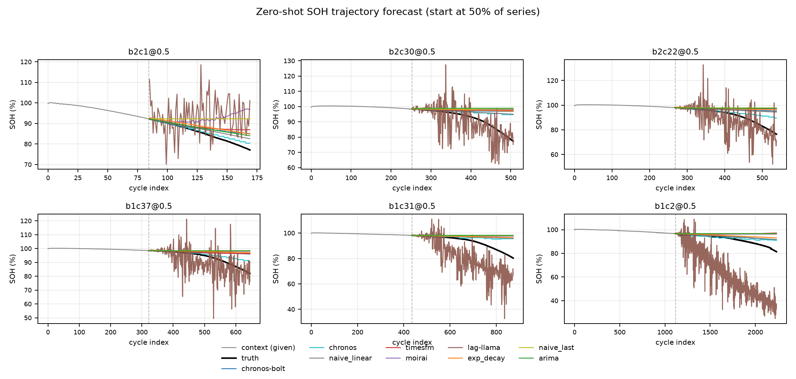
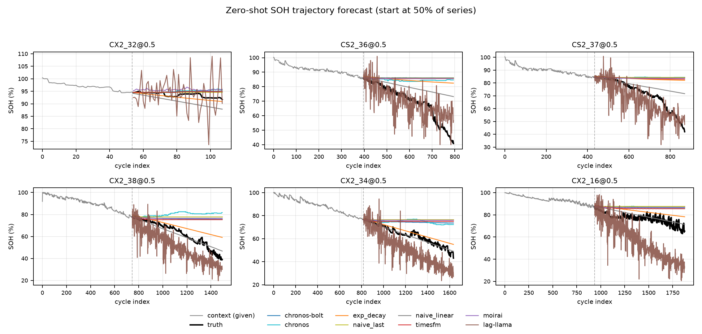
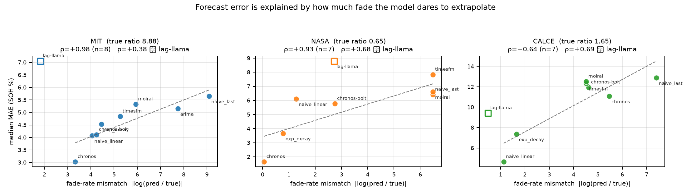

# 零样本时序基础模型，真的比线性外推更强吗？

### 一个在三个公开锂电池老化数据集上的可复现基准


把 Chronos、TimesFM、Moirai、Lag-Llama 当作**不认识电池的陌生人**：只看一段容量衰减历史、
**零训练、零微调**，去预测剩余寿命与未来 SOH，并与 naive_last / naive_linear / exp_decay / ARIMA
四个经典基线在**完全相同的协议**下对比。

结论一句话：**零样本基础模型不是普遍更强，它是否更强取决于数据有没有"膝点"。**

---

## 目录

- [主要结论](#主要结论)
- [基准设计](#基准设计)
- [结果](#结果)
- [机制：不是"更懂电池"，而是"敢不敢外推"](#机制不是更懂电池而是敢不敢外推)
- [快速开始](#快速开始)
- [目录结构](#目录结构)
- [复现性：我们踩过并修掉的坑](#复现性我们踩过并修掉的坑)
- [局限](#局限)
- [引用与许可](#引用与许可)

---

## 主要结论

| # | 结论 | 关键数字 |
|---|---|---|
| 1 | 零样本基础模型**不是普遍更强**：5 个模型里只有 Chronos-T5 在两个库上稳定领先 | MIT 3.02 vs 线性 4.07（−26%）；NASA 1.52 vs 3.65 |
| 2 | Chronos-Bolt 与线性外推**几乎等价**，差距统计显著但**没有实际意义** | Δ = +0.13 SOH%，p = 0.002 |
| 3 | 优势取决于**数据有没有膝点**，与模型本身无关 | MIT `knee_ratio` 8.88 → 基础模型赢；CALCE 1.65 → 线性外推赢（1.76–2.39×） |
| 4 | 这个排序**不是起点选择的假象**：40/50/60% 三个起点上 CALCE 结论都不变 | 线性 6.45 / 4.62 / 6.00，均为最优 |
| 5 | **few-shot 微调能翻转结论**：19 支电池把 Bolt 从 4.11 拉到 2.66 | −35%，反超所有零样本模型；1 支电池即 −21% |
| 6 | 微调只迁移"**敢外推**"，不迁移"**该多陡**" | CALCE EOL 命中 0% → 88%，但起点已偏低的电池被外推到接近 0（单支 MAE 109.8） |
| 7 | EOL 指标只在 NASA / CALCE 可用，且样本量小到**不足以支撑显著性结论**；NASA 只作方向性证据（排名随起点变化、种子 CV 30.6%，naive_linear 换整段拟合能从 6.11 降到 2.48） | NASA n=4（闸门后 3）、CALCE n=14（闸门后 8） |
| 8 | 结论对起点与种子稳健：三个起点、三个额外种子下排名均无翻转（NASA 除外） | MIT/CALCE 种子 CV ≤ 8.7%；NASA 30.6% |

> 全部数字见 [`04_文档报告/结果表.md`](04_文档报告/结果表.md)、
> 区间与 p 值见 [`03_实验结果/显著性检验.md`](03_实验结果/显著性检验.md)。

---

## 基准设计

### 数据（三个库，61 个 cell）

| 数据集 | 体系 | cells | SOH 观测区间 | `knee_ratio` | 用途 |
|---|---|---|---|---|---|
| [MIT-Stanford](02_数据集链接/MIT_MATR-1.md) | LFP / 18650 | 124（41/43/40 官方三划分） | 98.3 → 79.2 | **8.88** | 主战场：强膝点，且**在 EOL 处截断** |
| [NASA PCoE](02_数据集链接/NASA_PCoE.md) | LCO / 18650 | 4 | 83.3 → 72.4 | 0.65 | 小样本、衰减减速 |
| [CALCE UMD](02_数据集链接/CALCE_UMD.md) | LCO / 棱柱 | 14（27 个 zip 按电压窗口筛出全深度老化） | 84.4 → 42.8 | 1.65 | 反向检验：近线性衰减、区间最宽 |

三个库的 `knee_ratio`（未来斜率 / 上下文斜率）相差一个量级，这是本基准最重要的**数据属性**，
也是后面所有"结论反转"的根源。

### 模型

| 类型 | 模型 | 参数 | 上下文上限 | 解码 |
|---|---|---|---|---|
| 基础模型 | Chronos-Bolt-small | 48 M | 2048 | 分位数（确定性） |
| 基础模型 | Chronos-T5-small | 46 M | 512 | 20 样本取中位 |
| 基础模型 | TimesFM 2.5-200M | 200 M | 权重原生 16384，适配器按 **512** 配置 | 点预测 |
| 基础模型 | Moirai-1.0-R-small | 14 M | 512 | 100 样本取中位 |
| 基础模型 | Lag-Llama | **2.4 M** | **32**（原生） | 10 样本取中位 |
| 基线 | naive_last / naive_linear / exp_decay | — | — | 确定性 |
| 基线 | ARIMA | — | — | 确定性 |

> **关于 `naive_linear`**：它只对上下文**最近 ⌊n/2⌋ 个点**做最小二乘（电池序列开头常有容量平台，
> 纳入拟合会把斜率压平）。作者另跑了"整段拟合"变体：MIT 4.066 → 4.528、CALCE 4.623 → 6.275（本文版本更强），
> **但 NASA 6.111 → 2.478（整段更强）**。因此 NASA 只作方向性证据；该消融与讨论见短文 §3.2 脚注。

### 协议（写死，所有模型同口径）

- **切分**：相对起点 50%（敏感性 40/50/60%），用前半段猜后半段；
- **归一**：`SOH = 容量 / median(上下文前 5 点) × 100`，**因果、无泄漏**；
- **推理**：递归滚动，单次 horizon = 64（Chronos 上限 64，硬预测本就不可能），所有模型一致；
- **上下文**：默认各用自身上限（Bolt 2048 / T5 512 / TimesFM 512 / Moirai 512 / Lag-Llama 32）；另跑 `--max-context 512` 做**公平对照**（主表用 512）。
  注意 TimesFM 2.5 的权重声明支持 16384 上下文，是**适配器按 512 配置**的（`adapters/timesfm.py`），这一点与"它原生只有 512"是两回事；
- **评估真值**：Savitzky–Golay 平滑（窗口 11、阶 2），只用于评估参考，不进模型输入；
- **EOL**：SOH 首次 ≤ 80%；**闸门**——真值起点已 ≤ 80% 的 cell 不计入 EOL 分母（否则"未卜先知"）；
- **红线**：依赖缺失必须报错，**禁止静默返回随机数**。

---

## 结果

### MIT-Stanford 主测试集（43 cells，起点 50%，统一 512 上下文）

| 模型 | MAE ↓ | 95% CI | EOL 命中率 | 耗时 |
|---|---|---|---|---|
| **Chronos-T5-small（零样本）** | **3.02** | [2.40, 3.47] | 0% | 319 s |
| naive_linear | 4.07 | [3.76, 4.48] | 0% | 0.1 s |
| Chronos-Bolt-small（零样本） | 4.11 | [3.77, 4.82] | 0% | 14 s |
| exp_decay | 4.53 | [4.24, 5.52] | 0% | 58 s |
| TimesFM 2.5-200M | 4.84 | [4.44, 5.06] | 0% | 31 s |
| ARIMA | 5.15 | [4.89, 5.56] | 0% | 58 s |
| Moirai-1.0-R-small | 5.33 | [4.72, 5.82] | 0% | 144 s |
| naive_last | 5.65 | [5.19, 6.19] | 0% | 0.1 s |
| Lag-Llama（原生 32 上下文） | 7.05 | [6.38, 8.53] | 100%（提前 197 循环） | 502 s |
| **Chronos-Bolt + few-shot（19 支）** | **2.66** | — | 26% | 14 s |

MIT 内部 OOD（batch3，40 cells）：Chronos-Bolt **2.53** vs naive_linear 2.80 —— 基础模型首次反超。

### 跨库零样本（同一批模型，不重新训练）

| 排名 | NASA PCoE（4 cells，EOL 分母 3） | CALCE UMD（14 cells，EOL 分母 8） |
|---|---|---|
| 1 | **Chronos-T5 1.52**（EOL 3/3，误差 6.2 循环） | **naive_linear 4.62**（EOL 8/8） |
| 2 | exp_decay 3.65 | exp_decay 7.35 |
| 3 | Chronos-Bolt 5.75 | Lag-Llama 9.41 |
| 4 | naive_linear 6.11 | Chronos-T5 11.07 |
| 5 | naive_last 6.38 | Chronos-Bolt 11.94 |
| 6 | Moirai 6.58 | TimesFM 12.33 |
| 7 | TimesFM 7.80 | Moirai 12.51 |
| 8 | Lag-Llama 8.72 | naive_last 12.86 |

**同一个 Chronos-T5，在 MIT 上比线性外推好 26%，在 CALCE 上比线性外推差 139%。**
模型没变，变的是数据。

<p align="center">
  
  
</p>
<p align="center"><em>左：MIT（强膝点，基础模型敢于下探）；右：CALCE（近线性，基础模型把预测压成水平线）</em></p>

### 统计显著性：哪些差距可以当结论

- MIT 上 Chronos-T5 vs naive_linear：**Δ = −0.77，p < 0.001**（配对 Wilcoxon，n=43）——真实优势；
- MIT 上 Chronos-Bolt vs naive_linear：**Δ = +0.13，p = 0.002**——**显著地更差，但差得没有意义**；
- CALCE 上 4 个基础模型全部显著差于线性外推（p ≤ 0.001），Lag-Llama 例外（p = 0.078, n.s.）；
- NASA n=4：**样本量不足，不做检验**，只报方向与极宽的 bootstrap 区间。

> 这条"显著但无意义"是本基准刻意保留的方法论点：**p 值只能回答"是否可区分"，
> 不能回答"是否值得换"**。因此全文按效应量 + 机制排序，而不是按 p 值排序。

### 多随机种子方差

采样类模型（Chronos-T5 / Moirai / Lag-Llama）在默认种子之外另跑种子 1/2/3，
共 3 库 × 3 模型 × 3 种子。完整表见 [`03_实验结果/种子方差.md`](03_实验结果/种子方差.md)。

| 库 | Chronos-T5 | Moirai | Lag-Llama |
|---|---|---|---|
| MIT test（43 支） | 3.02 / 3.16 / 3.23 / 3.14（CV **2.7%**） | 5.33 / 5.13 / 5.12 / 5.12（2.0%） | 7.05 / 7.15 / 7.01 / 6.99（1.0%） |
| NASA（4 支） | 1.52 / 2.29 / 1.84 / 1.07（**30.6%**） | 6.58 / 5.95 / 6.55 / 7.20（7.7%） | 8.72 / 8.77 / 9.80 / 9.47（5.8%） |
| CALCE（14 支） | 11.07 / 10.65 / 10.18 / 10.66（3.4%） | 12.51 / 12.55 / 12.49 / 12.60（0.4%） | 9.41 / 7.75 / 9.09 / 9.31（**8.7%**） |

> 每格为「默认种子 / seed1 / seed2 / seed3」的中位 MAE，括号内为变异系数 CV。

- **MIT 与 CALCE 的排名在三个种子上无一处翻转**（CV 最大 8.7%，仍小于与下一名的差距）；
- **NASA 的 CV 达 30.6%**（1.07–2.29），只能当方向性证据；
- 种子极差（MIT T5 为 0.20）远小于 bootstrap CI 宽度（1.07）——**再加种子解决不了"只有 43 支电池"这个约束**。

---

## 机制：不是"更懂电池"，而是"敢不敢外推"

对每个 cell 计算两个量：

- `knee_ratio` = 预测段真值斜率 / 上下文真值斜率（**数据侧**，需要多少加速）；
- `pred_ratio` = 预测段降幅 / 真值降幅（**模型侧**，实际外推了多少）。

| 库 | 需要（`knee_ratio`） | Chronos-T5 给出 | 线性外推给出 | 结果 |
|---|---|---|---|---|
| MIT | 8.88 | 0.32（全场最高） | 0.15 | 基础模型赢 |
| CALCE | 1.65 | **0.01**（几乎水平线） | 0.54 | 线性外推赢 |

定义失配度 `mismatch = |log(pred_ratio / knee_ratio)|`，与 MAE 的 Spearman 秩相关：
MIT **+0.98**、NASA +0.93、CALCE +0.64（均不含 Lag-Llama）——
**"外推幅度是否匹配数据的加速需求"几乎单独决定了排名**。

Lag-Llama 是唯一偏离者（加入后 MIT ρ 掉到 +0.38）：它的降幅总量对得上（`pred_ratio` 1.43），
但**路径是错的**——递归 64 步每轮带噪声，曲线剧烈锯齿化，还会提前 197 循环跌破 80%。
这说明"总降幅"是必要条件而非充分条件。

<p align="center">
  
</p>

### 跨库迁移：微调学到的是"敢不敢外推"，不是"该多陡"

把 **MIT 微调后的 Chronos-Bolt（k=19）原样搬到 CALCE / NASA**，不做任何再训练：

| 库 | 零样本 Bolt | MIT 微调后 | 变化 |
|---|---|---|---|
| NASA（4 支） | 5.75 | **4.54** | −21% |
| CALCE 全体中位（14 支） | 11.94 | 13.24 | +11%（变差） |
| CALCE 正常起点（9 支） | 12.61 | **8.15** | **−35%** |
| CALCE 起点已 ≤80%（5 支） | 9.59 | 45.36 | +373%（灾难） |

EOL 命中率：CALCE **0% → 88%**，NASA 0% → 33%。

微调真正迁移过去的是"敢往下画"这个先验（`pred_ratio` 0.016 → 敢外推），
但"该画多陡"没有迁移好：起点已经偏低的电池被按 MIT 先验继续外推到接近 0
（单支 MAE 最高 109.8），把整体中位数反而拉高。
**工程判据：部署前先看起点 SOH，起点已明显低于额定健康度时必须重新标定衰减幅度。**

---

## 快速开始

### 0. 环境

```bash
git clone <this-repo> && cd <this-repo>

# 核心依赖（跑基线 + 加载数据即可，无需任何模型库）
bash scripts/setup_env.sh          # macOS / Linux / Git-Bash
# 或：scripts\setup_env.bat         # Windows CMD
```

基础模型依赖见 [`requirements-models.txt`](requirements-models.txt)。**两个环境**是刻意的：

- `venv`（Python 3.13）：Chronos / TimesFM / 全部基线 / few-shot 微调；
- `venv-moirai`（Python **3.12**）：Moirai / Lag-Llama —— uni2ts 硬依赖 `numpy~=1.26`，
  没有 cp313 wheel，与 `torch 2.14 + chronos-forecasting` 无法共存于同一 3.13 环境。

CPU 即可，无需 GPU。本文所有数字都是在 CPU（Windows 11 / torch 2.14.1）上跑出来的。

### 1. 数据

代码只**引用**数据路径，不复制、不改写原始文件。把数据放成下面这样即可零配置：

```
data/
├── MIT/          mit_cells.parquet, mit_cycles.parquet, MATR.zip
├── NASA_PCoE/    1. BatteryAgingARC-FY08Q4/*.mat
└── CALCE_UMD/    CS2_*.zip / CX2_*.zip
```

也可以不搬数据，用环境变量指向真实位置：

```bash
export BATTERY_DATA_ROOT=/path/to/datasets   # 总根
export MIT_CELLS=/path/mit_cells.parquet     # 或逐个覆盖
export NASA_MAT_DIR=/path/1.\ BatteryAgingARC-FY08Q4
export CALCE_DIR=/path/CALCE_UMD
```

或复制 [`01_源代码/configs/local_paths.example.py`](01_源代码/configs/local_paths.example.py)
为 `configs/local_paths.py` 直接写死（该文件已被 `.gitignore` 排除）。
各数据集的来源、字段与获取方式见 [`02_数据集链接/`](02_数据集链接/)。

### 2. 权重

```bash
export HF_ENDPOINT=https://hf-mirror.com      # 国内网络；海外可省略
export HF_HUB_DISABLE_XET=1                   # 镜像不支持 xet，不关会中断

hf download amazon/chronos-bolt-small       --local-dir shared/models/chronos-bolt-small
hf download amazon/chronos-t5-small         --local-dir shared/models/chronos-t5-small
hf download google/timesfm-2.5-200m-pytorch --local-dir shared/models/timesfm-2.5-200m-pytorch
hf download Salesforce/moirai-1.0-R-small   --local-dir shared/models/moirai-1.0-R-small
# Lag-Llama 权重：shared/models/lag-llama/lag-llama.ckpt（来源见 requirements-models.txt）
```

`resolve_model_ref()` 会自动优先用本地目录，**运行时不联网**。

### 3. 跑

```bash
cd 01_源代码

# 一格：MIT 主测试集上跑全部经典基线
../venv/Scripts/python.exe run_benchmark.py --model all-baselines --dataset mit --split test

# 一个基础模型
../venv/Scripts/python.exe run_benchmark.py --model chronos-bolt --dataset mit --split test

# 跨库
../venv/Scripts/python.exe run_benchmark.py --models chronos-bolt,naive_linear --dataset calce

# 汇总表 / 显著性 / 机制 / 种子方差
../venv/Scripts/python.exe report.py
../venv/Scripts/python.exe stats_significance.py
../venv/Scripts/python.exe analyze_shrinkage.py
../venv/Scripts/python.exe analyze_seeds.py

# 图（--runs 用分号分隔：结果目录名本身含逗号，所以不能用逗号分隔）
../venv/Scripts/python.exe figures.py --prefix mit_ \
  --runs "mit-zero-chronos-bolt,chronos,timesfm,naive_linear-ctx512;mit-zero-moirai;mit-zero-lag-llama;mit-zero-naive_last,naive_linear,exp_decay-refactor;mit-zero-arima"
../venv/Scripts/python.exe figures.py --prefix nasa_ \
  --runs "nasa-zero-chronos-bolt,chronos,timesfm,naive_linear,naive_last,exp_decay;nasa-zero-moirai;nasa-zero-lag-llama"
../venv/Scripts/python.exe figures.py --prefix calce_ \
  --runs "calce-zero-chronos-bolt,chronos,timesfm,naive_linear,naive_last,exp_decay;calce-zero-moirai;calce-zero-lag-llama"
```

一键全矩阵（表 1–表 5 + 图 1–图 6 的原始数据，约 10 小时 CPU）：

```bash
bash scripts/run_matrix.sh all
```

输出在 `03_实验结果/<dataset>-<setting>-<models>/`：`per_cell_*.csv`、`summary.json`
（含协议参数、包版本、权重路径、耗时、随机种子）、`predictions_*.npz`。

---

## 目录结构

```
01_源代码/
├── configs/config.py        路径解析 + 协议参数 + 模型注册表 + HF 镜像（唯一真源）
├── data/loaders.py          MIT / NASA / CALCE 真实加载器（CALCE 带 parquet 缓存）
├── data/protocol.py         清洗 / SOH 归一 / 相对起点切分 / 平滑参考
├── adapters/base.py         Forecaster 接口 + 批量滚动递归 rolling_forecast_batch
├── adapters/                chronos / timesfm / lagllama / moirai（各自独立种子推进）
├── baselines/classic.py     naive_last / naive_linear / exp_decay / ARIMA
├── evaluation/metrics.py    MAE / RMSE(SOH) + EOL 误差 + RUL 误差 + 命中率
├── run_benchmark.py         一行命令复现一格（--models / --max-context / --start-fracs / --seed）
├── report.py                汇总 summary.json → 结果表.md + 汇总表.csv
├── stats_significance.py    bootstrap CI + 配对 Wilcoxon → 显著性检验.md
├── analyze_shrinkage.py     pred_ratio / 失配度 / 秩相关 → 衰减保留率.csv + fig5
├── analyze_seeds.py         多种子方差与排名翻转检查 → 种子方差.md
├── diag_curvature.py        knee_ratio（数据侧衰减加速比）
├── fewshot_finetune.py      Chronos-Bolt 真梯度微调（k 支电池）+ 跨库迁移
└── figures.py               轨迹图 / 箱线图 / EOL 命中率 / 起点敏感性
02_数据集链接/                三个数据集的来源、字段与获取方式（只写路径，不存数据）
03_实验结果/                  每次运行的 per_cell / summary / predictions + 汇总与检验
04_文档报告/                  短文初稿、方案、执行记录、结果表、figures、_history（历史材料）
scripts/                      setup_env.{sh,bat} + run_matrix.sh（全矩阵）
requirements-core.txt         核心依赖（基线所需）
requirements-models.txt       模型依赖（已实测可共存的版本组合 + 踩坑记录）
```

---

## 复现性：我们踩过并修掉的坑

> **已验证**：把仓库 `git clone` 到干净目录，不重跑任何模型、只跑汇总脚本
> （`report.py` / `stats_significance.py` / `analyze_shrinkage.py` / `analyze_seeds.py` / `figures.py`），
> 生成的 `mit_fig1_trajectories.png`、`calce_fig4_sensitivity.png`、`fig5_shrinkage.png`
> 与原图 **MD5 逐位一致**。也就是说提交的结果文件与图完全对应，中间没有手工改数。

这部分是本项目最有价值的部分之一——**每一个坑都会让数字悄悄错掉，而且不报错**：

| # | 坑 | 症状 | 修法 |
|---|---|---|---|
| 1 | 采样类模型**没有设种子** | Lag-Llama 在 NASA 上重跑一次从 7.73 变成 8.70（+12.6%） | 每次采样前 `manual_seed(seed + call_count)`，调用顺序确定 ⇒ 可复现且各 chunk 不复用同一噪声 |
| 2 | 结果**依赖 batch 组成** | NASA B0005@0.5：4 个任务一批时 0.802，12 个任务一批时 1.034 | `run_model` 按 `start_frac` 分组后再组 batch，使某格永远落在同一组成的批里 |
| 3 | `summary.json` 按**模型名**去重合并 | 分两次跑 CALCE 敏感性（0.4/0.5 然后 0.6），前一次的 frac 被抹掉 | 改成按 `模型@起点` 完整键去重 |
| 4 | fig4 三个库**生成同一张图**（MD5 相同） | 敏感性图的运行目录是全局常量，只指向 MIT | 改为按数据集前缀索引；缺数据时打印"跳过（不生成假图）" |
| 5 | Δ 的点估计**落在自己的 CI 之外** | +0.46 落在 [+0.57, +0.89] 里 | 点估计改用"配对差的中位数"，与 CI 同源 |
| 6 | EOL 分母算错 | NASA 说 4/4，实际 B0006 起点 72.1% < 80%，被闸门剔除 ⇒ 应为 3/4 | 修正闸门逻辑并全文更正 |
| 7 | 上下文长度**不公平** | Bolt 用 2048、T5 用 512，差距里混进了上下文长度 | 主表统一 `--max-context 512`，另保留原生长度做对照 |
| 8 | Windows 上 `pandas` 先于 `torch` 导入 | `OSError [WinError 1114] c10.dll 初始化例程失败` | `run_benchmark.py` 顶部按需预导入 torch |
| 9 | 依赖缺失时**静默返回随机数** | 原版脚本"看起来跑成功了"，其实全是噪声 | 依赖缺失一律抛 `NotInstalledError`，禁止兜底 |

细节见 [`04_文档报告/执行记录-2026-10-20.md`](04_文档报告/执行记录-2026-10-20.md)。

---

## 局限

1. **EOL 指标太脆**：MIT 在 EOL 处截断（数据没有"跌破 80% 之后"的样本），零样本模型"差一点"就到不了，
   命中率恒为 0%；NASA 闸门后只剩 3 支，CALCE 剩 8 支，**都不足以做显著性检验**。
   本基准因此以 SOH 轨迹误差为主指标，EOL 只作辅助。
2. **Lag-Llama 的上下文被 32 卡住，而且它是五个模型里规模最小的（实测权重 2.4 M 参数，仅为 Chronos-T5-small 的 1/19）**：
   原生上下文与其他模型的 512 不可比，容量差距也极大。
   已单独标注；但它在 MIT 上仍是最差（7.05），说明"提前 197 循环跌破 80%"不能只归因于上下文长度或参数规模。
3. **只有 LFP 与 LCO 两个体系**：没有 NCM/NCA、没有快充工况、没有温度维度。
4. **few-shot 只做了 Chronos-Bolt**：其余四个模型的微调接口差异大，未覆盖。
5. **全部在 CPU 上跑**：单次全矩阵约 10 小时，因此只做了 3 个额外种子（不是 10 个）。
6. **`knee_ratio` 是事后量**：它需要真值才能算，只能用于**解释**已发生的结果，
   不能作为部署时的先验判据。要做在线判据需要另找只看上下文的代理指标。

---

## 引用与许可

代码 MIT，见 [`LICENSE`](LICENSE)。**数据与权重不随仓库分发**，请按各自许可从原始来源获取。

如果这个基准对你有帮助：

```bibtex
@software{zhicheng_tsfm_battery_2026,
  title  = {Do Zero-Shot Time-Series Foundation Models Beat Simple Baselines
            for Battery SOH Prediction? A Three-Dataset Benchmark},
  author = {ilo-love7},
  year   = {2026},
  note   = {https://github.com/ilo-love7/battery-soh-tsfm-benchmark},
  license = {MIT}
}
```

也可直接使用 [`CITATION.cff`](CITATION.cff)（GitHub 会显示 "Cite this repository"）。

---

*最后更新：2026-10-21 ｜ 短文初稿见 [`04_文档报告/短文初稿-v1.md`](04_文档报告/短文初稿-v1.md)*
